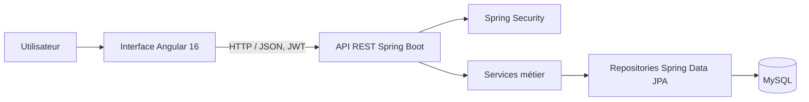
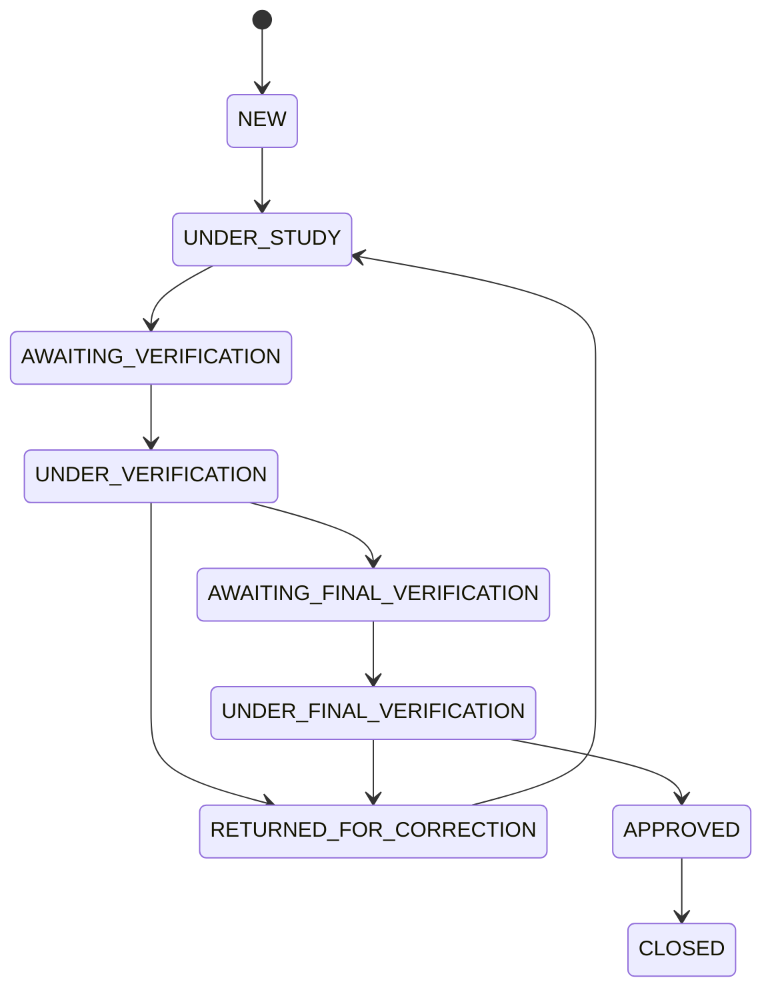

# Rapport de stage — Application de gestion des dossiers fonciers de l’ONPF

> **Version de travail à personnaliser avant dépôt.** Les éléments entre crochets doivent être complétés à partir des informations de l’étudiant et de l’établissement. Les descriptions techniques sont fondées sur les documents du projet et une lecture des fichiers présents dans le dépôt. Les tests, dates et résultats non documentés ne sont pas présentés comme réalisés.

## Documents analysés et informations manquantes

Documents consultés : `README.md`, `DOCUMENTATION_FONCTIONNELLE.md`, `DEVELOPER_GUIDE.md`, `SETUP.md`, `journal_stage_ONPF.md`, `PROMPT_CLAUDE_RAPPORT_STAGE.md`, configuration Angular et Maven, routes, services Angular, contrôleurs et classes du backend, ainsi que les fichiers SQL de la base.

À compléter : identité de l’étudiant, établissement et formation, encadrants, dates exactes, année universitaire, service d’accueil, description institutionnelle officielle, captures d’écran et résultats réels des tests. Le journal décrit dix semaines d’activités, mais ses dates et certains accomplissements sont à faire confirmer par le stagiaire et son encadrant.

## Table des matières

1. Page de garde  
2. Remerciements  
3. Résumé et mots-clés  
4. Abstract and keywords  
5. Introduction générale  
6. Organisme d’accueil  
7. Étude de l’existant et besoins  
8. Analyse et conception  
9. Réalisation  
10. Sécurité  
11. Tests et validation  
12. Difficultés rencontrées  
13. Limites et perspectives  
14. Conclusion générale  
15. Bibliographie et webographie  
16. Annexes proposées  
17. Informations à fournir par l’étudiant  
18. Vérifications avant dépôt  

# 1. Page de garde

**[ÉTABLISSEMENT : À COMPLÉTER]**  
**[FORMATION / DÉPARTEMENT : À COMPLÉTER]**

## Rapport de stage

### Conception et développement d’une application web de gestion et de suivi des dossiers fonciers

**Organisme d’accueil :** Office National de la Propriété Foncière (ONPF), Tunisie  
**Étudiant(e) :** [À COMPLÉTER]  
**Encadrant professionnel :** [À COMPLÉTER]  
**Encadrant académique :** [À COMPLÉTER]  
**Période du stage :** [À COMPLÉTER]  
**Année universitaire :** [À COMPLÉTER]

[Insérer ici le logo de l’établissement et, si autorisé, celui de l’organisme.]

# 2. Remerciements

Je tiens à remercier l’Office National de la Propriété Foncière pour m’avoir accueilli(e) dans le cadre de ce stage et m’avoir permis de travailler sur un projet lié à la gestion des dossiers fonciers.

J’adresse mes remerciements à **[nom de l’encadrant professionnel]**, pour son accompagnement et ses conseils tout au long du stage, ainsi qu’à **[nom de l’encadrant académique]** pour son suivi pédagogique. Je remercie également les personnes qui ont contribué à la compréhension du besoin et au déroulement de cette expérience.

> Adapter ce texte aux personnes effectivement rencontrées et aux contributions reçues.

# 3. Résumé

Ce stage porte sur l’analyse et la réalisation d’une application web administrative destinée à faciliter le suivi des dossiers fonciers et des documents juridiques à l’ONPF. Le besoin étudié est de structurer les étapes de traitement d’un dossier, de la phase d’étude à la vérification puis à la décision finale, en tenant compte des rôles des utilisateurs.

La solution prend la forme d’une application composée d’une interface Angular et d’une API Java Spring Boot, avec une base MySQL. Elle comprend notamment des écrans de connexion, de consultation et de recherche de dossiers, de traitement selon plusieurs étapes, de statistiques et de journalisation des opérations. L’interface est conçue en arabe avec une disposition droite-à-gauche (RTL). L’accès est organisé autour des rôles d’éditeur, de vérificateur et de vérificateur senior, avec une authentification JWT prévue dans le flux applicatif.

Le travail a permis de mettre en place ou de documenter les principaux éléments du parcours métier et de l’architecture technique. L’état de fonctionnement global, la validation sur une base réelle et les résultats de tests doivent être confirmés avant le dépôt du rapport.

**Mots-clés :** gestion foncière, application web, Angular, Spring Boot, JWT, workflow.

# 4. Abstract

This internship focuses on the analysis and development of an administrative web application designed to support the tracking of real estate files and legal documents at Tunisia’s National Real Estate Ownership Bureau (ONPF). The identified need is to structure the processing of a file from study through verification to a final decision, while taking user responsibilities into account.

The solution is organized as an Angular web interface, a Java Spring Boot API and a MySQL database. It includes screens for authentication, file consultation and search, workflow processing, statistics and operation history. The user interface is designed in Arabic with right-to-left (RTL) layout support. Access is organized around editor, verifier and senior verifier roles, with JWT authentication in the application flow.

The work covers the main business workflow and technical architecture. The overall operational status, validation against a production-like database and test results must be confirmed before the report is submitted.

**Keywords:** land management, web application, Angular, Spring Boot, JWT, workflow.

# 5. Introduction générale

## 5.1 Contexte

La gestion de dossiers fonciers implique la consultation de données administratives et de pièces justificatives, ainsi que le suivi des différentes décisions prises pendant leur traitement. Une application dédiée peut rendre ces étapes plus visibles et conserver une trace des opérations effectuées.

Le stage a été consacré à un projet d’application administrative pour l’ONPF. Le dépôt contient une interface web, un backend, des scripts de base de données et une documentation de démarrage et de fonctionnement.

## 5.2 Problématique

Comment proposer un outil web qui organise le traitement des dossiers fonciers, distingue les responsabilités des intervenants et facilite la consultation de l’état d’avancement et de l’historique des opérations, tout en répondant aux besoins d’une interface arabophone ?

## 5.3 Objectifs

Les objectifs décrits dans les documents du projet sont les suivants :

- permettre l’authentification et organiser les accès selon le rôle ;
- consulter, créer et rechercher des dossiers ;
- suivre leur progression entre étude, vérification et validation finale ;
- consulter et gérer les documents associés pendant les étapes prévues ;
- présenter des statistiques et un journal des opérations ;
- fournir une interface arabe avec une disposition RTL.

## 5.4 Méthodologie

Le journal de stage décrit une progression en dix semaines : prise en main de l’environnement, analyse du besoin et des rôles, étude de l’architecture et des données, réalisation des écrans, travail sur l’authentification et les étapes du workflow, puis revue et documentation. Les dates de chaque période restent à compléter.

La démarche technique suit une séparation entre interface, API et stockage. Les fonctionnalités passent par des composants Angular et des services HTTP ; côté serveur, les contrôleurs exposent des routes REST et délèguent le traitement à des services et repositories.

## 5.5 Organisation du rapport

Le rapport présente d’abord l’organisme et le besoin, puis les acteurs, les choix de conception et les éléments de réalisation. Il expose ensuite les aspects de sécurité et de validation, avant de présenter les limites, les perspectives et le bilan du stage.

# 6. Présentation de l’organisme d’accueil

L’ONPF est identifié dans les documents du projet comme l’Office National de la Propriété Foncière en Tunisie, organisme concerné par la gestion et le suivi de dossiers fonciers. Les sources locales décrivent une application liée à l’étude des dossiers et aux documents juridiques.

Les informations institutionnelles détaillées — historique, missions officielles, organisation, directions et service d’accueil — ne figurent pas dans les documents analysés. Elles doivent être ajoutées à partir de sources officielles ou validées par l’encadrant.

**Service concerné :** [À COMPLÉTER : nom du service, missions et lien avec le projet.]  
**Environnement du stage :** [À COMPLÉTER : équipe, outils, modalités de travail.]

# 7. Étude de l’existant et analyse des besoins

## 7.1 Situation étudiée

Le projet vise à centraliser dans une application la consultation des dossiers et de leurs documents, le suivi de leur état et l’enregistrement des opérations. Les documents disponibles ne décrivent pas précisément les outils ou procédures antérieurs. Il ne serait donc pas justifié d’affirmer qu’un processus manuel ou un système antérieur présentait des défaillances particulières.

## 7.2 Acteurs

| Acteur | Responsabilité décrite |
|---|---|
| Éditeur (`EDITOR`) | Créer et étudier un dossier, compléter les informations et les documents, puis le transmettre à la vérification. |
| Vérificateur (`VERIFIER`) | Examiner les dossiers et documents, approuver leur transmission à l’étape suivante ou demander une correction. |
| Vérificateur senior (`SENIOR_VERIFIER`) | Effectuer la vérification finale, prendre une décision finale et gérer les utilisateurs selon les accès documentés. |
| Administrateur (`ADMIN`) | Mentionné dans certains éléments de contexte du routage ; périmètre opérationnel à confirmer dans l’application. |

## 7.3 Besoins fonctionnels

Les fonctionnalités couvertes par les routes, services ou écrans documentés comprennent :

- se connecter et transmettre un jeton d’authentification aux requêtes ;
- consulter une liste paginée, filtrer et rechercher des dossiers ;
- créer un dossier et consulter son détail ;
- ajouter ou supprimer des documents pendant la phase d’étude ;
- transmettre un dossier à la vérification, approuver ou demander une correction ;
- vérifier les documents et effectuer une vérification finale ;
- consulter les statistiques, les opérations et les comptes utilisateurs ;
- configurer les paramètres de l’application.

La présence d’une route ou d’un écran ne suffit pas à démontrer que toute la fonctionnalité est intégrée et validée de bout en bout. Les écrans Paramètres, Diagnostic, gestion utilisateurs et certains parcours nécessitent une confirmation fonctionnelle avant d’être déclarés terminés.

## 7.4 Besoins non fonctionnels et contraintes

- **Sécurité :** authentification, contrôle d’accès par rôle et protection des API.
- **Traçabilité :** associer les opérations à un dossier et à leur auteur.
- **Accessibilité linguistique :** interface principalement en arabe et affichage RTL.
- **Maintenabilité :** séparation du frontend, du backend et des données.
- **Compatibilité technique :** Angular 16, Java 11, Spring Boot 2.7.14 et MySQL sont indiqués par les configurations consultées.
- **Déploiement :** les guides décrivent un lancement local de développement ; un déploiement institutionnel n’est pas documenté.

# 8. Analyse et conception

## 8.1 Architecture générale

L’architecture est organisée en trois parties : frontend Angular, backend Spring Boot exposant une API REST et base MySQL. Les échanges entre le navigateur et le serveur s’effectuent en JSON. L’URL locale de l’API est généralement configurée autour de `http://localhost:8080/api`, et le serveur de développement Angular autour de `http://localhost:4200`.

## 8.2 Organisation logicielle

Le frontend regroupe les pages, composants de mise en page, services, guards et intercepteur HTTP. Le backend suit une organisation en contrôleurs, services métier, repositories, modèles, DTO et composants de sécurité. Les contrôleurs consultés délèguent le traitement des dossiers à `FileWorkflowService`.

## 8.3 Modèle de données

Les quatre tables décrites dans la documentation sont :

| Table | Rôle |
|---|---|
| `users` | Comptes et rôles des utilisateurs. |
| `real_estate_files` | Informations, état et données d’enregistrement des dossiers fonciers. |
| `legal_documents` | Documents rattachés à un dossier. |
| `operations` | Historique des actions et de leur auteur. |

Les informations cadastrales et certaines informations d’enregistrement final sont décrites comme stockées sous forme JSON. La documentation signale également un script de migration pour les colonnes cadastrales. Le schéma détaillé et les cardinalités peuvent être ajoutés en annexe à partir de `database/schema.sql`.

## 8.4 Workflow d’un dossier

Les états documentés comprennent `NEW`, `UNDER_STUDY`, `AWAITING_VERIFICATION`, `UNDER_VERIFICATION`, `RETURNED_FOR_CORRECTION`, `AWAITING_FINAL_VERIFICATION`, `UNDER_FINAL_VERIFICATION`, `APPROVED` et `CLOSED`.

Ce diagramme synthétise les états énumérés dans la documentation et le journal. Les transitions exactes, leurs conditions et l’état terminal effectif doivent être confirmés avec le comportement actuel du service métier.

## 8.5 Routes et API principales

Les écrans Angular documentés sont `/login`, `/dashboard`, `/files`, `/files/:id`, `/study/:id`, `/verification/:id`, `/final-verification/:id`, `/operations-log`, `/search`, `/users`, `/settings` et `/debug`. Les routes d’étude et de vérification utilisent des contrôles de rôle dans le routeur Angular.

Exemples de routes REST définies dans les contrôleurs et services :

| Méthode | Route | Fonction |
|---|---|---|
| POST | `/auth/login` | Authentifier un utilisateur. |
| GET | `/files` | Lister, paginer et filtrer les dossiers. |
| GET | `/files/{id}` | Consulter un dossier. |
| POST / PUT | `/files`, `/files/{id}` | Créer ou modifier un dossier. |
| POST | `/files/{id}/assign-to-verification` | Transmettre le dossier à la vérification. |
| POST | `/files/{id}/approve` | Enregistrer une approbation. |
| POST | `/files/{id}/return-for-correction` | Demander une correction. |
| GET | `/files/statistics` | Obtenir les statistiques. |
| GET | `/operations` | Consulter le journal des opérations. |
| GET / POST / PUT | `/users`, `/users/{id}` | Consulter et gérer les utilisateurs selon les droits. |

# 9. Réalisation

Les éléments ci-dessous sont décrits à partir des écrans et fichiers présents. « Présent dans le dépôt » ne signifie pas que le parcours a été testé en intégration.

| Partie | Éléments observés et objectif | État à présenter |
|---|---|---|
| Connexion | Page de connexion, `AuthService`, appel `POST /auth/login`, stockage des informations de session dans le navigateur. | Implémentation présente ; connexion réelle à valider avec le backend et une base configurée. |
| Tableau de bord | Écran dédié et route de statistiques `/files/statistics`. | Présent ; exactitude des chiffres et intégration à confirmer. |
| Liste et création de dossiers | Page `FilesComponent`, formulaire décrit, filtres et pagination exposés par le service/contrôleur. | Éléments présents ; parcours complet à valider. |
| Détail du dossier | Page `FileDetailsComponent` consacrée à la consultation des informations et pièces. | Présente ; vérifier chargement et affichage des données réelles. |
| Étude | Page `StudyComponent`, modification et gestion des pièces prévues pendant l’étude. | Présente ; droits et transitions à tester. |
| Vérification | Page `VerificationComponent`, contrôles de documents, approbation et retour pour correction. | Présente ; résultats d’exécution non documentés. |
| Vérification finale | Page `FinalVerificationComponent`, réservée au vérificateur senior dans le routage. | Présente ; décision finale et référence d’enregistrement à valider. |
| Recherche | Page dédiée et paramètres de recherche documentés dans l’API. | Présente dans le dépôt ; pertinence et comportement à confirmer. |
| Journal des opérations | Écran et contrôleur d’opérations décrits. | Présents ; exhaustivité de la journalisation à confirmer. |
| Utilisateurs | Écran `UsersComponent`, routes prévues pour consultation et gestion. | Présent ; accès indiqué comme réservé au vérificateur senior. |
| Paramètres / diagnostic | Écrans `SettingsComponent` et `DebugComponent`. | Présents ; périmètre exact des réglages et statut de diagnostic à vérifier. |
| Interface arabe et RTL | Document HTML et styles globaux prévoient la langue arabe et le sens droite-à-gauche. | Prise en charge décrite ; revue visuelle multi-écrans à effectuer. |

## 9.1 Frontend Angular

Le frontend utilise Angular 16 et TypeScript, avec SCSS, Bootstrap, Bootstrap Icons et des dépendances Angular Material / ng-bootstrap déclarées dans `package.json`. Les routes sont centralisées dans `app-routing.module.ts`. Les services Angular isolent les appels HTTP, tandis que les guards contrôlent l’accès aux pages et que l’intercepteur ajoute les en-têtes d’authentification.

## 9.2 Backend et persistance

Le backend utilise Spring Boot 2.7.14, Spring Web, Spring Data JPA, Spring Security, un connecteur MySQL et la bibliothèque JJWT, selon `backend/pom.xml`. Les entités correspondent notamment aux utilisateurs, dossiers, documents et opérations. Les contrôleurs observés exposent les opérations REST et appellent le service métier de workflow. Les détails de chaque règle métier doivent être rapportés après validation du code et des scénarios.

## 9.3 Captures à insérer

- [Insérer ici une capture d’écran : page de connexion en arabe.]
- [Insérer ici une capture d’écran : tableau de bord.]
- [Insérer ici une capture d’écran : liste et filtres des dossiers.]
- [Insérer ici une capture d’écran : détail et documents d’un dossier.]
- [Insérer ici une capture d’écran : étape de vérification ou journal des opérations.]

# 10. Sécurité

Le flux frontend documenté appelle `POST /auth/login`, conserve un JWT sous la clé `auth_token` et joint un en-tête `Authorization: Bearer …` aux requêtes authentifiées. Un intercepteur HTTP et les guards `AuthGuard` et `RoleGuard` sont présents.

Côté serveur, `SecurityConfig`, `JwtTokenProvider`, `JwtAuthenticationFilter` et `CustomUserDetailsService` figurent dans le dépôt. Le contrôleur des dossiers applique notamment des annotations `@PreAuthorize` aux opérations de création, modification, approbation et retour en correction. Cette vérification serveur complète le contrôle de navigation de l’interface.

Le jeton est décrit comme stocké dans le stockage navigateur. La protection contre les risques liés à ce choix, la configuration de la clé JWT, la durée de vie des jetons, les paramètres HTTPS et la gestion de révocation doivent être examinés avant une mise en production. Les mots de passe de démonstration mentionnés dans les guides ne doivent pas être considérés comme des identifiants de production.

# 11. Tests et validation

## 11.1 Tests documentés comme réalisés

Le journal mentionne une relecture du parcours et une harmonisation des autorisations, mais ne fournit ni compte rendu de tests, ni jeux de données, ni résultats reproductibles. Aucun résultat détaillé ne peut donc être affirmé dans ce rapport sans confirmation du stagiaire.

## 11.2 Scénarios à exécuter ou à documenter

- authentifier un compte valide et vérifier le refus d’un compte invalide ;
- créer un dossier avec les champs requis, puis le retrouver dans la liste et sa fiche ;
- vérifier la pagination, les filtres et la recherche ;
- vérifier qu’un éditeur peut étudier et transmettre un dossier ;
- vérifier qu’un vérificateur peut examiner les pièces, approuver ou renvoyer pour correction ;
- vérifier qu’un vérificateur senior peut traiter la vérification finale ;
- tenter les mêmes opérations avec un rôle non autorisé ;
- confirmer l’ajout, la suppression et la vérification des documents ;
- vérifier la présence de l’acteur et de l’action dans le journal ;
- vérifier l’affichage RTL sur plusieurs tailles d’écran ;
- confirmer l’intégration de l’interface, de l’API et de MySQL.

**Résultats à compléter :** [Pour chaque scénario, indiquer date, environnement, résultat observé et anomalie éventuelle.] Les dépendances de test sont présentes dans les configurations, mais leur présence ne prouve pas que des tests ont été exécutés.

# 12. Difficultés rencontrées et solutions apportées

Le journal de stage fait ressortir plusieurs sujets de travail : compréhension d’un workflow à plusieurs intervenants, cohérence entre rôle et état du dossier, échanges entre frontend et backend, et adaptation d’une interface arabe au sens RTL.

Les réponses techniques décrites dans les fichiers sont la séparation des écrans par étape, l’utilisation de guards et de contrôles côté API, l’échange REST/JSON et l’application de styles RTL. Les difficultés individuelles, les erreurs rencontrées, les arbitrages et leurs résultats doivent être complétés par le stagiaire, car le journal ne rapporte pas d’incidents précis.

- Difficulté concrète rencontrée : [À COMPLÉTER]
- Analyse de la cause : [À COMPLÉTER]
- Solution effectivement appliquée : [À COMPLÉTER]
- Résultat observé : [À COMPLÉTER]

# 13. Limites et perspectives

Les suites mentionnées dans le journal ou suggérées par l’état documentaire comprennent :

- compléter les tests unitaires, d’intégration et de parcours ;
- valider l’application avec une configuration MySQL représentative ;
- vérifier que toutes les transitions métier sont appliquées côté serveur ;
- préciser le périmètre des écrans Paramètres et Diagnostic ;
- contrôler la cohérence entre documentation, contrats API et implémentation ;
- renforcer la gestion des secrets, des jetons et des configurations pour un environnement de production ;
- réaliser une revue de l’interface RTL et du responsive design ;
- préparer le déploiement, la sauvegarde des données, la supervision et la maintenance.

Il s’agit de pistes à évaluer avec l’équipe. Leur priorité et leur statut ne sont pas établis par les documents consultés.

# 14. Conclusion générale

Le stage a porté sur un projet de gestion web des dossiers fonciers qui associe un frontend Angular, un backend Spring Boot et une base MySQL. Le périmètre fonctionnel décrit couvre l’authentification, la consultation et la création de dossiers, leur circulation entre plusieurs étapes de vérification, la recherche et la traçabilité des opérations.

Le travail consigné dans le journal aborde l’analyse des rôles, l’architecture, l’interface arabe RTL, la sécurité et les parcours métier. Cette expérience mobilise des compétences en développement web, conception d’API, modélisation des données et prise en compte des droits d’accès. L’évaluation précise des objectifs atteints doit être complétée par les résultats vérifiés des tests et par le retour de l’encadrant.

**Apports personnels à préciser :** [À COMPLÉTER : compétences acquises, responsabilités réellement assumées et bilan personnel.]

# 15. Bibliographie et webographie

## Sources du projet

- *README.md*, dépôt du projet ONPF.
- *DOCUMENTATION_FONCTIONNELLE.md*, documentation fonctionnelle et technique du projet.
- *DEVELOPER_GUIDE.md*, guide de référence développeur.
- *SETUP.md*, guide d’installation.
- *database/schema.sql* et scripts de migration, schéma de données du projet.
- *backend/pom.xml* et *frontend/package.json*, déclarations des dépendances.

## Références technologiques

Les documentations officielles suivantes peuvent être ajoutées à la version finale après vérification de leurs éditions et URL :

- Angular — documentation officielle : https://angular.dev/
- Spring Boot — documentation officielle : https://docs.spring.io/spring-boot/
- Spring Security — documentation officielle : https://docs.spring.io/spring-security/reference/
- MySQL — documentation officielle : https://dev.mysql.com/doc/

> Les pages exactes consultées et leurs dates de consultation sont à compléter si elles sont citées dans le corps du rapport. Ajouter toute source institutionnelle officielle utilisée pour présenter l’ONPF.

# 16. Annexes proposées

- **Annexe A :** arborescence du projet.
- **Annexe B :** schéma relationnel extrait de `database/schema.sql`.
- **Annexe C :** exemples de requêtes et réponses API anonymisées.
- **Annexe D :** captures des écrans principaux.
- **Annexe E :** guide d’installation et de lancement local.
- **Annexe F :** tableau détaillé des scénarios de test et résultats observés.
- **Annexe G :** extraits courts du modèle de données et du workflow.

# 17. Informations à fournir par l’étudiant

- Nom et prénom de l’étudiant(e).
- Nom de l’établissement, département et formation.
- Nom et fonction de l’encadrant professionnel.
- Nom et fonction de l’encadrant académique.
- Dates de début et de fin du stage, périodes exactes des semaines du journal.
- Année universitaire.
- Service / équipe d’accueil et description validée de l’ONPF.
- Missions réellement réalisées par le stagiaire et contributions individuelles.
- Difficultés effectivement rencontrées et solutions appliquées.
- Environnement d’exécution et configuration réellement utilisée.
- Résultats des tests qui ont été exécutés, ou confirmation qu’aucun test formel n’a été mené.
- Captures d’écran autorisées et anonymisées.
- Sources officielles consultées et dates de consultation.
- Bilan personnel et remerciements adaptés aux personnes concernées.

# 18. Vérifications avant dépôt

- [ ] Remplacer tous les champs « À COMPLÉTER » par des informations exactes.
- [ ] Faire confirmer les rôles, transitions du workflow et fonctionnalités par l’encadrant.
- [ ] Distinguer clairement les fonctionnalités présentes, testées et encore à valider.
- [ ] Ajouter des résultats de tests reproductibles, sans en inventer.
- [ ] Insérer des captures autorisées et anonymiser toute donnée personnelle.
- [ ] Ajouter les sources institutionnelles et vérifier les références web.
- [ ] Relire l’orthographe, harmoniser les termes et contrôler la numérotation.
- [ ] Appliquer le modèle de mise en page demandé par l’établissement et exporter vers Word/PDF.

# 19. Dossier de contexte détaillé à transmettre à Claude

> **Mode d’emploi :** transmettre à Claude l’intégralité de ce fichier, et si possible joindre également `rapport-stage-contexte.zip`. Lui demander d’utiliser les sections 1 à 18 comme brouillon et les données de cette annexe comme contexte technique vérifié, puis de produire un rapport final cohérent. Les données personnelles et les réalisations personnelles restent à fournir par l’étudiant. Ne pas présenter les valeurs de démonstration comme des données réelles de l’ONPF.

## 19.1 Prompt à copier dans Claude

Tu es spécialiste en rédaction de rapports universitaires de stage informatique. À partir de ce document complet et des fichiers joints, révise et rédige un rapport de stage cohérent, professionnel et naturel en français.

Règles :

1. Utilise uniquement les informations explicitement présentes dans ce document ou les fichiers joints. N’invente ni dates, ni noms, ni missions personnelles, ni résultats de test, ni statistiques, ni faits institutionnels.
2. Distingue les faits du dépôt, les éléments mentionnés dans le journal du stagiaire, les affirmations de la documentation et les informations à confirmer. Lorsque les sources diffèrent, explique l’écart plutôt que de le masquer.
3. Les fonctionnalités observées dans le code peuvent être décrites comme « présentes dans le code » ou « implémentées côté API/interface » ; ne les déclare pas « validées en exploitation » sans preuve d’exécution.
4. Utilise [À COMPLÉTER] pour les renseignements personnels et institutionnels manquants. Ne prends pas les valeurs d’exemple ni les identifiants de démonstration pour des renseignements authentiques.
5. Corrige les répétitions et incohérences de la version de travail, développe les parties académiques de façon équilibrée et conserve les termes techniques exacts.
6. Présente les écarts constatés dans une sous-section dédiée « Limites et écarts constatés ». Insiste notamment sur les rôles, les données générées automatiquement de démonstration et les tests non documentés.
7. Garde les diagrammes Mermaid lisibles ou remplace-les par une description si l’outil de conversion final ne les prend pas en charge.
8. Fournis un rapport complet prêt à être personnalisé, avec page de garde, remerciements, résumé, abstract, table des matières, chapitres, conclusion, références, annexes, liste des informations manquantes et checklist de dépôt.
9. À la fin, fournis une liste courte des informations que l’étudiant doit encore ajouter. Ne prétends pas que ces informations ont été fournies.

## 19.2 Informations fiables sur le dépôt et le projet

Le dépôt décrit une application web administrative intitulée dans les documents comme un système de gestion de l’étude des dossiers fonciers et des documents juridiques de l’ONPF en Tunisie. Il contient deux volets applicatifs (frontend et backend), un répertoire de scripts SQL, un backend simulé local dans `backend-mock`, des guides de lancement et de la documentation. La présence de `backend-mock` indique qu’un serveur simulé est prévu/présent pour le développement ; elle ne prouve pas que chaque scénario ait été testé avec celui-ci.

La finalité fonctionnelle est de suivre les dossiers fonciers et les pièces juridiques à travers une étude, une première vérification, une vérification finale et une éventuelle correction. L’interface est principalement en arabe avec une disposition RTL. Le détail officiel de l’organisme, la direction d’accueil, les personnes impliquées et les procédures préexistantes ne sont pas décrits avec suffisamment de précision dans les documents du dépôt.

### Stack technique précisée par les configurations

| Élément | Donnée constatée |
|---|---|
| Frontend | Angular 16, TypeScript, SCSS |
| Bibliothèques interface | Bootstrap 5, Bootstrap Icons, Angular Material, Angular CDK, ng-bootstrap |
| Programmation réactive | RxJS 7 |
| Backend | Java 11, Spring Boot 2.7.14 |
| Accès aux données | Spring Data JPA / Hibernate |
| Sécurité | Spring Security, JWT avec JJWT, BCrypt |
| Base relationnelle | MySQL, pilote Connector/J 8.0.33 |
| API | HTTP REST et JSON ; contexte serveur Spring `/api`, port 8080 |
| Frontend de développement | serveur Angular usuellement sur le port 4200 |
| Compilation backend | Maven |
| Tests configurés | Spring Boot Test, Spring Security Test, Jasmine/Karma et script Angular `ng test` |
| Source de ces données | `frontend/package.json`, `backend/pom.xml`, `backend/src/main/resources/application.yml` |

Les guides indiquent notamment JDK 11 ou plus, Maven 3.6 ou plus, Node 16 ou plus, npm 8 ou plus et MySQL 5.7 ou plus. Il s’agit d’exigences décrites dans les guides, pas d’un relevé de l’environnement effectivement utilisé par l’étudiant.

## 19.3 Frontend : éléments et parcours

Le routage se trouve dans `frontend/src/app/app-routing.module.ts`. Il contient :

- `/login` : authentification ;
- `/dashboard` : statistiques / vue de synthèse ;
- `/files` : liste et création de dossiers ;
- `/files/:id` : détails d’un dossier ;
- `/study/:id` : étude, rôle `EDITOR` ;
- `/verification/:id` : vérification initiale, rôle `VERIFIER` ;
- `/final-verification/:id` : vérification finale, rôle `SENIOR_VERIFIER` ;
- `/operations-log` : historique des opérations ;
- `/search` : recherche ;
- `/users` : gestion des comptes, rôle `SENIOR_VERIFIER` ;
- `/settings` : paramètres ;
- `/debug` : diagnostic, déclaré hors du groupe de routes nécessitant le guard principal ;
- route vide redirigeant vers le tableau de bord et route inconnue redirigeant vers `dashboard`.

Le layout général comprend des composants de navigation, d’en-tête et de contenu. Les pages se trouvent dans `frontend/src/app/pages/`; services, guards et intercepteur se trouvent respectivement dans `services/`, `guards/` et `interceptors/`.

Services principaux :

- `AuthService` : connexion, utilisateur courant et vérification des rôles ; `POST /auth/login` ; jeton et profil conservés dans le stockage local du navigateur selon la documentation.
- `FileService` : liste, détail, création, modification, statistiques, assignation à la vérification, approbation, retour pour correction, opérations, vérification de pièces et gestion des documents. L’URL déclarée est `http://localhost:8080/api`.
- `UserService` : liste, création et modification d’utilisateurs sous `/users`.

L’intercepteur `AuthInterceptor` ajoute un bearer token et le type de contenu JSON aux appels appropriés. Les guards Angular améliorent la navigation par rôle ; ils ne remplacent pas la vérification d’autorisation côté API.

## 19.4 API backend observée dans les contrôleurs

Les contrôleurs sont sous `backend/src/main/java/tn/gov/onpf/controller/`. Le serveur applique le préfixe de contexte `/api` ; les routes suivantes sont donc données relativement à `/api`.

### Authentification — `AuthController`

- `POST /auth/login` : accepte username/password, authentifie le compte, renvoie un jeton JWT et un profil (id, username, email, fullName, role).
- `POST /auth/change-password` : exige le mot de passe courant, puis un nouveau mot de passe d’au moins huit caractères ; encode le nouveau mot de passe avec BCrypt.
- La présence d’un endpoint logout ou profil utilisateur dans le contrôleur n’est pas observée, malgré leur mention dans une liste de endpoints « à implémenter » du guide développeur.

### Dossiers — `FileController`

- `GET /files?page=&size=&status=&fileNumber=&lotNumber=&q=` : liste paginée et filtres/recherche.
- `GET /files/{id}` : détail.
- `POST /files` : création, autorisée au rôle `EDITOR`.
- `PUT /files/{id}` : modification, autorisée au rôle `EDITOR`.
- `POST /files/{fileId}/documents` : ajout, rôle `EDITOR`.
- `DELETE /files/{fileId}/documents/{documentId}` : suppression, rôle `EDITOR`.
- `POST /files/{id}/assign-to-verification` : rôle `EDITOR`.
- `POST /files/{id}/approve` : rôles `VERIFIER` et `SENIOR_VERIFIER`, puis traitement distinct selon le rôle dans le service.
- `POST /files/{id}/return-for-correction` : rôles `VERIFIER` et `SENIOR_VERIFIER`.
- `POST /files/{fileId}/documents/{documentId}/verify` : rôles `VERIFIER` et `SENIOR_VERIFIER`.
- `GET /files/statistics` : agrège les dossiers par états et total.

### Utilisateurs, opérations et santé

- `GET /users`, `POST /users`, `PUT /users/{id}` : le contrôleur est protégé au niveau de la classe par `SENIOR_VERIFIER`. La création encode le mot de passe et exige au moins huit caractères ; l’édition gère certaines protections contre la désactivation du dernier vérificateur senior actif et contre l’auto-rétrogradation du compte courant.
- `GET /operations?page=&size=` et `GET /operations/file/{fileId}?page=&size=` : liste paginée du journal global ou d’un dossier. Le service limite la taille de page maximale à 100 et trie les entrées par date décroissante.
- `GET /health` : route de santé sans authentification dans la configuration de sécurité. Le contrôleur correspondant est `HealthController`.

## 19.5 Workflow serveur constaté

Le service de workflow est `backend/src/main/java/tn/gov/onpf/service/FileWorkflowService.java`. Les contrôleurs appellent ce service pour les règles d’état et la journalisation.

- Création : crée un dossier en `NEW`, associe l’éditeur courant comme responsable d’étude et affectation initiale, peut enregistrer les documents initiaux et journalise la création.
- Mise à jour : admise en `NEW`, `UNDER_STUDY` ou `RETURNED_FOR_CORRECTION`. Les champs reçus sont modifiés ; un dossier `NEW` ou retourné passe à `UNDER_STUDY`.
- Documents : ajout et suppression admis dans les états d’étude listés ci-dessus. Une pièce créée commence avec le statut `PENDING`.
- Transmission : depuis `UNDER_STUDY` ou `RETURNED_FOR_CORRECTION`, assigne le dossier au premier vérificateur actif disponible et fait passer l’état à `AWAITING_VERIFICATION`.
- Vérification d’une pièce : vérifie que la pièce appartient au dossier, écrit le résultat et le statut de pièce. Si le dossier attend la vérification initiale, seul un utilisateur `VERIFIER) peut l’ouvrir en `UNDER_VERIFICATION). Si le dossier attend la vérification finale, seul un `SENIOR_VERIFIER) peut l’ouvrir en `UNDER_FINAL_VERIFICATION).
- Approbation par `VERIFIER` : permise sur `AWAITING_VERIFICATION` ou `UNDER_VERIFICATION`, assigne au premier vérificateur senior actif et passe à `AWAITING_FINAL_VERIFICATION`.
- Approbation par `SENIOR_VERIFIER` : permise sur `AWAITING_FINAL_VERIFICATION` ou `UNDER_FINAL_VERIFICATION`, puis passe à `APPROVED`.
- Retour pour correction : chaque niveau peut renvoyer à l’éditeur depuis ses états d’attente ou de traitement correspondants ; le responsable d’étude redevient destinataire et l’état devient `RETURNED_FOR_CORRECTION`.
- Journal : le service enregistre type d’opération, états antérieur/nouveau, notes, dossier, utilisateur et date. Les libellés d’opération observés sont arabes.
- Statistiques : renvoie total et compteurs par plusieurs états de dossier.

### Point particulier sur les données de validation finale

Dans le service présent, l’approbation senior génère automatiquement des champs de démonstration pour la référence d’enregistrement (numéro de formalité, volume, folio, date du jour, visa, numéro de certificat). Certaines références sont calculées à partir de l’identifiant du dossier avec des préfixes fixes. Le rapport ne doit pas les présenter comme des numéros officiels ou des données produites par un vrai système de registre. Il faut les décrire comme données générées par le code de démonstration et à remplacer/valider selon le besoin réel.

## 19.6 Schéma de données

Le script principal est `database/schema.sql`, base `onpf_db`, encodage `utf8mb4`.

| Table | Colonnes / règles principales observées |
|---|---|
| `users` | id auto-incrémenté, username unique, password, email unique, full_name, rôle enum, is_active, created_at, updated_at. |
| `real_estate_files` | file_number unique, lot_number, subject, filing_date, status enum, source, étude-responsable et utilisateur affecté, notes, cadastral_data, registration_data, dates de création / modification. |
| `legal_documents` | file_id, type, numéro, date, état `PENDING/VERIFIED/REJECTED`, notes, résultat `APPROVED/REJECTED/PENDING`, dates. Les pièces sont supprimées en cascade avec le dossier. |
| `operations` | file_id, user_id, operation_type, previous_status, new_status, notes, timestamp. Les opérations sont supprimées en cascade avec le dossier. |

Les dossiers ont neuf états : `NEW`, `UNDER_STUDY`, `AWAITING_VERIFICATION`, `UNDER_VERIFICATION`, `RETURNED_FOR_CORRECTION`, `AWAITING_FINAL_VERIFICATION`, `UNDER_FINAL_VERIFICATION`, `APPROVED`, `CLOSED`. Les colonnes cadastrales et d’enregistrement sont stockées en LONGTEXT et converties en JSON par le service. Les tables ont des index sur différents identifiants, états, dates et clés d’affectation.

Le SQL inclut trois comptes d’exemple nommés `editor_user`, `verifier_user` et `senior_verifier`, et indique un mot de passe en clair de démonstration `password` associé à des hash BCrypt dans le script. Ce sont des données d’exemple/documentation. Leur validité dans une installation courante n’a pas été testée ; ne pas présenter ces comptes comme comptes réels de l’organisme.

## 19.7 Sécurité et configuration observées

`SecurityConfig` configure une API stateless, désactive CSRF, permet sans authentification `POST /auth/login` et `GET /health`, exige l’authentification ailleurs, utilise BCrypt et installe `JwtAuthenticationFilter` avant le filtre username/password. La configuration renvoie 401 pour absence/expiration d’authentification et 403 pour accès interdit. Des annotations de méthode `@PreAuthorize` protègent les contrôleurs concernés.

Dans `application.yml), le serveur est configuré sur le port 8080 avec context path `/api), datasource locale `jdbc:mysql://localhost:3306/onpf_db), utilisateur `root), mot de passe vide, et Hibernate `ddl-auto: validate`. Le secret JWT de configuration est explicitement un texte provisoire `your-secret-key-change-this-in-production-environment-with-a-strong-key`. Cette configuration est locale/de développement et ne constitue pas une configuration sûre pour la production. Ne pas reproduire le secret ni des mots de passe dans une publication du rapport ; expliquer seulement qu’une valeur de remplacement doit être configurée dans un environnement sécurisé.

## 19.8 Écarts et précautions techniques à rapporter

- Les rôles SQL/Java/frontend observés sont `EDITOR`, `VERIFIER`, `SENIOR_VERIFIER`. Un `ADMIN` est évoqué dans l’ancien contexte documentaire du projet, mais n’est pas dans l’énumération de rôle SQL ni dans le type TypeScript de `UserService`. Le routage consulté réserve `/users` à `SENIOR_VERIFIER` et n’expose pas de règle `ADMIN`. Décrire cette différence comme un écart documentaire, pas comme un rôle opérationnel validé.
- Le guide développeur marque plusieurs routes « To be implemented », alors que des contrôleurs correspondants et un service de workflow sont actuellement présents dans le dépôt. Dire que le guide semble partiellement obsolète ; les fonctionnalités restent à valider en exécution.
- Le journal de stage rapporte des tâches effectuées par le stagiaire sur dix semaines. Ce journal est une déclaration de travail fournie dans le dépôt, pas une preuve indépendante de tests ni une mesure de qualité. Conserver son contenu mais laisser les périodes à compléter.
- Les fichiers de tests ne sont pas répertoriés dans le contexte analysé ; seules les dépendances de test sont configurées. Ne pas déduire des résultats de test.
- Le frontend possède un script `npm test`, mais cela ne prouve ni que des tests existent ni qu’ils ont été lancés.
- Le projet prévoit une base MySQL et possède un serveur mock, mais aucune preuve dans ces éléments ne démontre une mise en production ou un déploiement à l’ONPF.
- Les routes du contrôleur `FileController` mettent un contrôle de rôle sur les modifications et étapes de workflow ; certains GET ne portent pas d’annotation de rôle spécifique, tout en restant soumis à l’authentification globale. Ne pas interpréter une protection de navigation Angular comme l’unique protection.
- Les informations sur la situation avant projet, les problèmes métier mesurés et les gains obtenus ne sont pas présentes. Les formuler comme contexte/besoin du projet, sans inventer un diagnostic comparatif ou des pourcentages.
- L’application gère des métadonnées de documents (type, numéro, date, statut) ; les sources examinées ne permettent pas d’affirmer qu’elle stocke les fichiers numériques eux-mêmes.

## 19.9 Informations personnelles qui ne sont pas dans le dépôt

Ces champs doivent être renseignés directement par l’étudiant :

- nom/prénom, genre ou forme de civilité si le modèle de l’école l’exige ;
- établissement, département, spécialité, niveau et année universitaire ;
- intitulé officiel et période exacte du stage ;
- noms et fonctions des encadrants ;
- service ou direction d’accueil, équipe et environnement réel de travail ;
- tâches effectivement réalisées par l’étudiant, en distinguant contribution individuelle et travail d’équipe ;
- environnement réellement utilisé (versions installées, base, serveur local ou mock) ;
- problèmes rencontrés et solutions réellement apportées ;
- tests effectivement joués, avec dates, configuration, résultats et preuves ;
- captures autorisées, anonymisées et conformes aux règles de confidentialité ;
- bilan personnel et personnes à remercier ;
- sources institutionnelles et bibliographiques réellement consultées.

